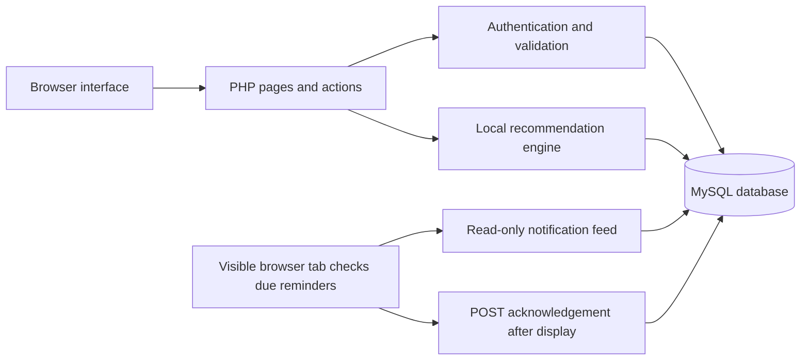

# Implementation alignment with the thesis

This implementation supports the three objectives and the project scope in Chapter One of Dawa nThesis.docx. The source chapter is a requirements reference; its research claims and citations require independent academic verification before submission.

| Thesis requirement | Implementation | Evidence to show |
| --- | --- | --- |
| Create, edit, delete, categorise, schedule and monitor tasks | My tasks, shared task editor, personal categories, status and deadline filters | Create a task, change its category and deadline, start it, complete it and reopen it |
| AI-assisted prioritisation | Local expert system using importance, deadline proximity, postponements, status and recent category delays | AI assistant factor table; deterministic tests; score changes as deadline approaches |
| Timely reminder support | Manual and AI-suggested scheduling, in-app alerts, optional browser notifications | Accept or edit a suggestion; observe a due alert while app is open |
| Human control and understandable behavior | Visible score factors and timing explanation; accept/change/ignore options | Ignore a recommendation; verify the task deadline is unchanged |
| Reduce unnecessary interruption | Configurable quiet hours, delivery toggle, maximum three visible reminders | Due feed is suppressed during quiet hours; snooze/dismiss demonstration |
| Completion history and dashboard | Task audit history, active/today/overdue/completed counts and completion charts | Complete a task and show its history event and updated dashboard |
| User authentication and isolation | Per-user SQL predicates, secure password hashes, session regeneration and POST/CSRF checks | Two-account integration tests reject cross-account edits and reminder actions |
| Evaluation of usefulness and ease of use | Proposed comparative protocol and questionnaire | Conduct and report the actual study in Chapter Six |

## Architecture

PHP renders pages on the server and uses prepared PDO statements to read or update MySQL. The AI module contains pure functions for ranking and reminder timing, plus database adapters that aggregate the signed-in user's observations. Browser JavaScript progressively adds confirmation dialogs, accessible notifications, and browser-alert permission controls. Core task and reminder management remains usable without JavaScript; automatic delivery requires it.

## Data model

| Table | Purpose and key relationships |
| --- | --- |
| users | Account name, unique email, password hash and fixed account time zone |
| categories | Built-in categories and categories owned by one user |
| tasks | Owner, category, description, deadline, importance, status, postponement count, completion time and derived AI fields |
| reminders | Task and owner, scheduled time, manual/AI type, user decision, delivery and dismissal states |
| task_history | Task changes such as creation, completion, postponement and editing |
| user_activity | Sign-in and task/reminder interactions for the audit trail |
| app_preferences | Quiet hours, preferred reminder hour and alert toggle; one row per user |

Foreign keys preserve relationships. Deleting a user cascades to their records; deleting a category leaves its tasks uncategorised; deleting a task removes its reminders and task history. Existing project records are preserved by the additive preferences-table upgrade.

## Important boundaries to explain

The expert-system score is an ordinal recommendation, not a probability. Rule weights are design choices, not empirically optimised coefficients. Behavioral summaries require at least three observations and remain weak evidence, especially with small samples. A completion hour does not necessarily measure a person's preferred working hour.

The prototype does not access external calendars, run unattended background notifications, send email, understand arbitrary natural-language requests, estimate task duration, or use a trained generative model. These limits are consistent with a focused implementation, but must be stated in the dissertation.

The application can demonstrate functionality and support a study. Its existence alone cannot answer whether productivity or usability improved. The research questions require actual participant observations and analysis.

## Suggested report evidence

- Chapter Three: justify the development method, requirements selection and evaluation design.
- Chapter Four: include architecture, entity relationships, scoring rules, data validation and test strategy.
- Chapter Five: capture your own screenshots of registration, task management, factor explanations, reminder review and analytics.
- Chapter Six: report measured test outcomes separately from participant findings, missing data and limitations.
- Chapter Seven: identify improvements supported by findings, such as UTC storage, better empirical weight tuning and reliable background delivery.

Check the institution's policy on assisted development and acknowledge assistance as required. Be prepared to explain the code, demonstrate the system, and justify its limitations in your own words.
